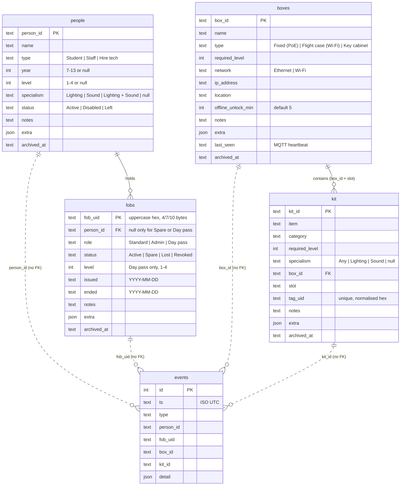

# Data model

SQLite (`bun:sqlite`), WAL mode, foreign keys on. Migrations are numbered files in
`hub/migrations/` (`001_initial.sql`, …), each applied in its own transaction at
start-up and recorded in `schema_migrations`. The DB schema version (in `/api/health`)
is separate from the workbook schema version (`Read me!B2`, currently `1`).

Also: `import_batches` (pending/applied/superseded workbook uploads: file hash, parsed rows,
preview diff, error count, applied-by fob and time) and `settings` (key/value:
`students_disabled`, `show_mode`, `auto_signout_date`, `workbook_readme`, `workbook_extra_columns`).

Added in migration 002 (desk panel, weeks 3–4):

- `events.type` also allows `kit_denied` (a refused Take/Return) and `tap_denied` (a fob the
  panel wouldn't open a card for). Extra indexes on `fob_uid`, `box_id` and `type`.
- `boxes.lock_state` (`locked` / `open`, from `box/<id>/state`) and `lock_state_at`. Hub-owned,
  never in the workbook. Panel box status: *never seen* (no `last_seen`), *offline* (no heartbeat
  for 90 s), else *open* / *locked*.
- `panel_changes`: one row per field changed on the panel (`sheet`, `row_id`, `field` = DB
  column or `*` for a row the panel created, old and new value as JSON, the admin `fob_uid`, the
  `admin_action` `event_id`). `exported_at` is set by an export; `resolved_at` when an import's
  "use sheet" overrode it. Open rows (both NULL) are what the importer checks for conflicts.

## Rules

- **Enums** are stored as the exact workbook text and enforced with `CHECK`.
- **Archiving, not deleting.** A row missing from an applied import gets `archived_at` set
  (people → `Status = Left`, fobs → `Status = Revoked`, `Ended` = today). Archived rows are
  hidden from export, the diff and access decisions. Re-adding the same ID in a later
  workbook un-archives it. Nothing referenced by `events` ever disappears.
- **`events` is append-only**: triggers abort any `UPDATE` or `DELETE`. It has no foreign
  keys so a tap from an unknown fob can still be logged as `box_denied`.
- **`extra`** holds unknown workbook columns per row, so export can write them back.
- **Location from day one**: every kit item has `box_id` + `slot`.
- **"Out with"** is derived, not stored: the latest `kit_out`/`kit_in` event per `kit_id`.
- **Signed in** is derived the same way: the latest `sign_in`/`sign_out` per person (or per fob
  for a guest day pass with no person).
