# 9. The desk panel

[← Rebuild and handover](Rebuild-and-Handover.md) · [Home](Home.md) · Next: [Lock boxes →](Lock-Boxes.md)

The 10.1" touchscreen on the desk, run by the Pi behind it. Crew tap a fob on the reader in
the side pod to sign in, take and return kit, and open boxes. An **admin fob** (Daniel, Mrs Ritter,
the sealed spare) gets the same card with a red **Admin panel** button. It never touches Eos, QLab or the WING.

## Waking it

The screen turns **off after 5 minutes** with nobody using it.

- **Tap a fob**: the screen comes on and the card opens straight away.
- **Touch the screen**: the screen comes on. That first touch **only wakes it**; it doesn't press
  anything underneath. Touch again to use it.

## The screens

| Screen | What it does |
| --- | --- |
| 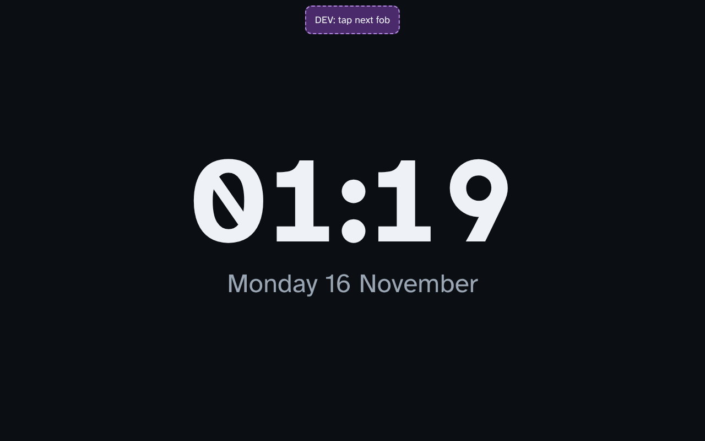 **Clock** | Nobody tapped in: only the time and date. Nothing about people or kit is on show. |
| 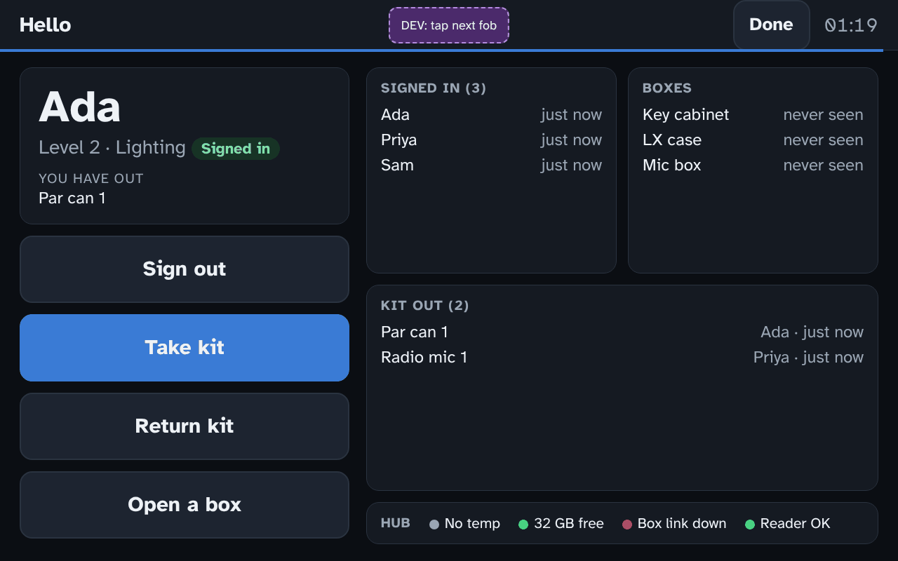 **Crew card** | After a crew fob tap. Left: first name, level and specialism, what they have out, and big buttons. Right: who's signed in, box status, kit out and who has it, hub health. Closes after **30 s** without a touch (the blue line under the top bar runs down). **Done** closes it now. **Sign in / Sign out** is only there for students and guests: staff and hire techs don't sign in. |
| 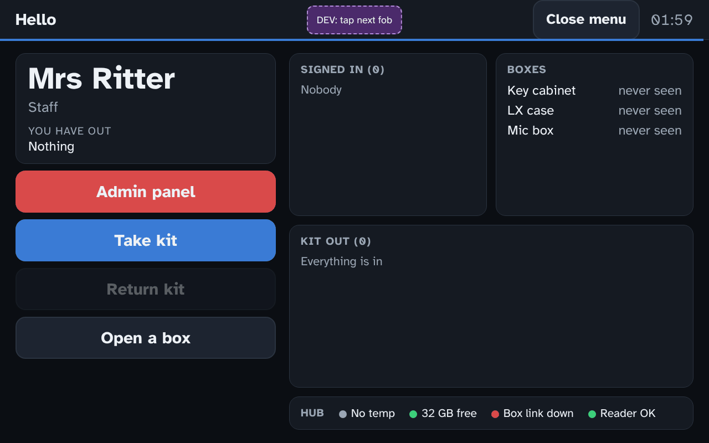 **Admin card** | After an admin fob tap: the same card, plus a red **Admin panel** button at the top. Take kit and Open a box list everything (the admin fob is the master key). A student with an admin fob (Daniel) still has Sign in. Closes after 90 s. |
| 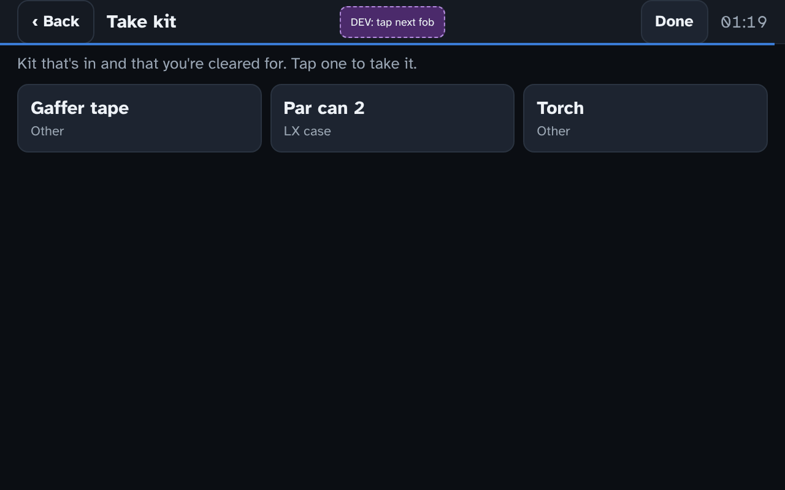 **Take kit** | Only kit that's **in** and that **this person is cleared for** (level and specialism). Tapping an item logs it out to them and opens its box. If they can't open that box, they can't take it. |
| **Return kit** | Their own kit only. Opens its box again if they're cleared for it; if not, it says to ask a staff member to open the box. |
| 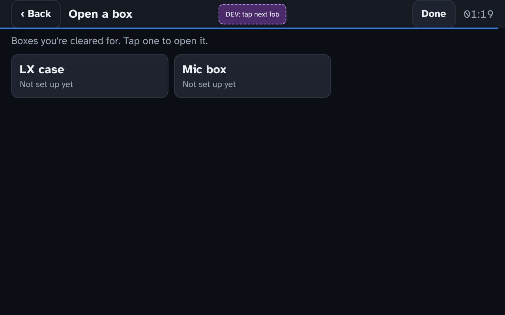 **Open a box** | Boxes they're cleared for. Until the boxes are built (week 5) every box says *Not set up yet* and the panel says to ask a staff member. |
| 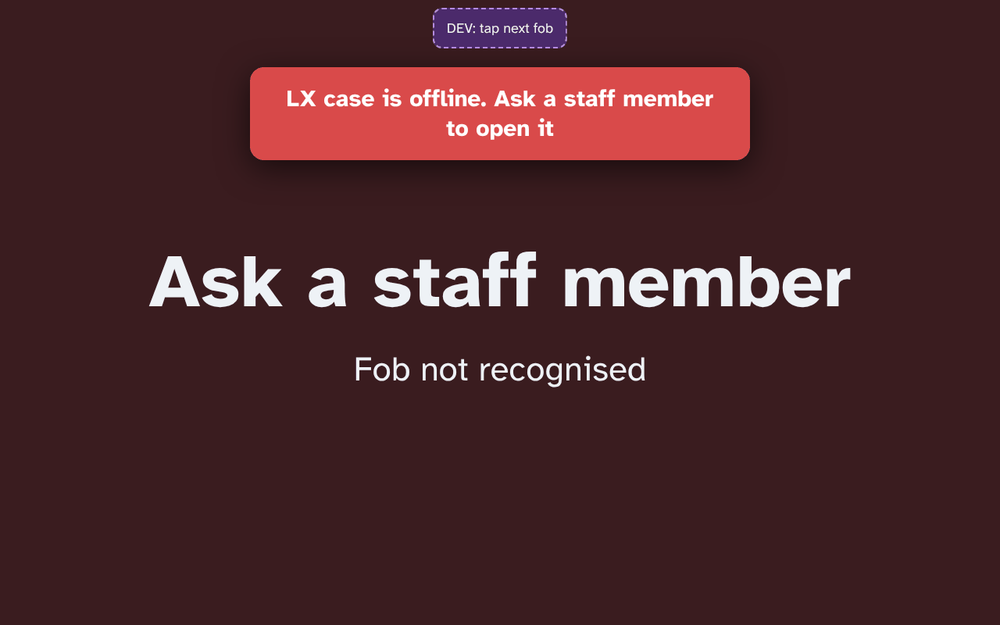 **Ask a staff member** | A fob the panel won't accept, with the reason ("Fob not recognised", "This fob is Lost", "Students are disabled right now", "Day pass has expired"…). Goes back to the clock after 8 s or a touch. |
| 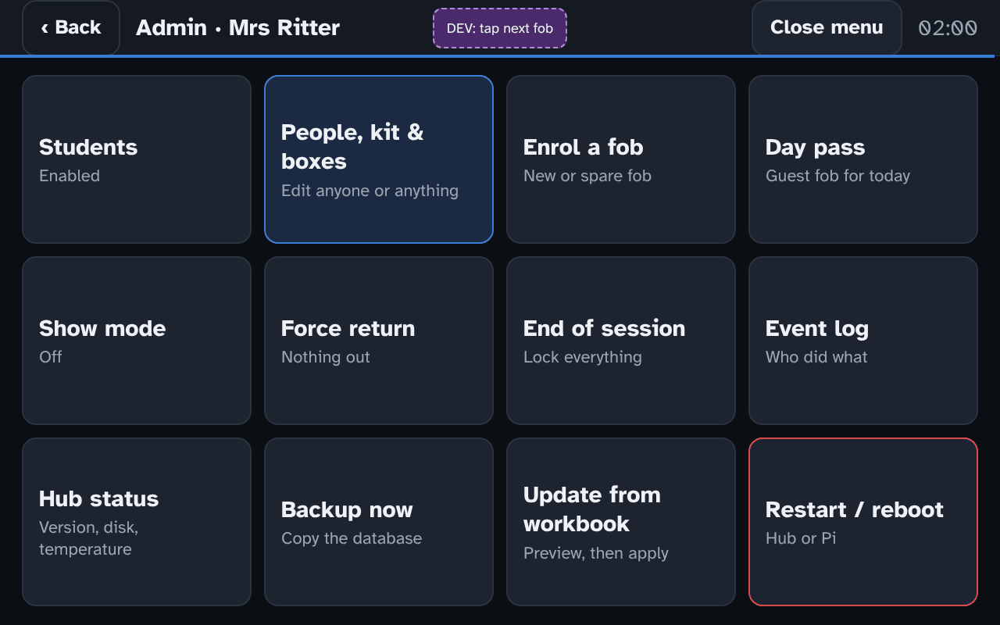 **Admin menu** | **Admin panel** on an admin card. Back returns to the card. Closes after **90 s** without a touch. |
| 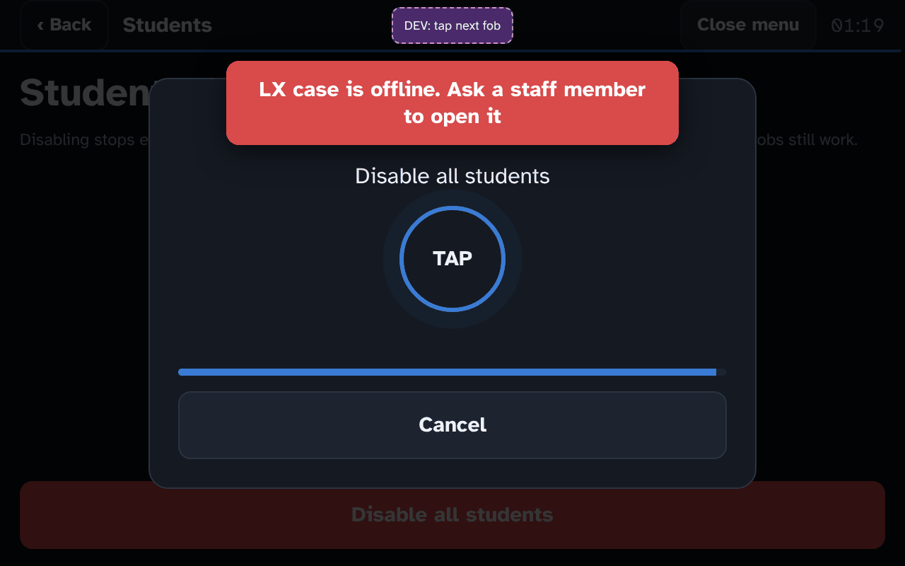 **Tap to confirm** | Risky actions wait for **any active admin fob** to be tapped within 20 s: disable students, show mode, force return, restart / reboot, apply a workbook. A crew fob is refused. **Cancel** stops it. Edits in People, kit & boxes don't need it. |

### Admin menu

| Button | Notes |
| --- | --- |
| **Students** | "Disable all students" stops every student fob (desk, boxes, kit). Staff, hire techs, day passes and admin fobs still work. Re-enabling needs no confirm. |
| **People, kit & boxes** | The editor: see below. |
| **Enrol a fob** | Tap *Enrol*, tap the new fob, then pick the person or **+ Add a new person** (name with the on-screen keyboard, type, year, level, specialism). Choose Standard or Admin and the Issued date. New people get the next `P###`. Lost and revoked fobs are never reused. 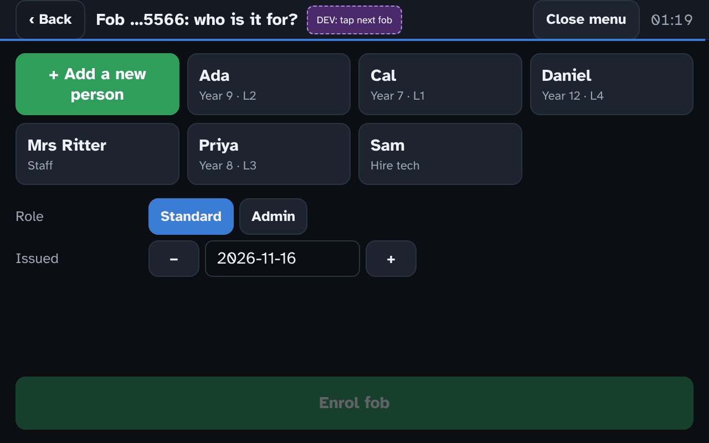 |
| **Day pass** | Tap a **Spare** fob (or an old day pass), type the company / reason, pick Level 1–4 (default 1). Works **today only**. Notes records who issued it. 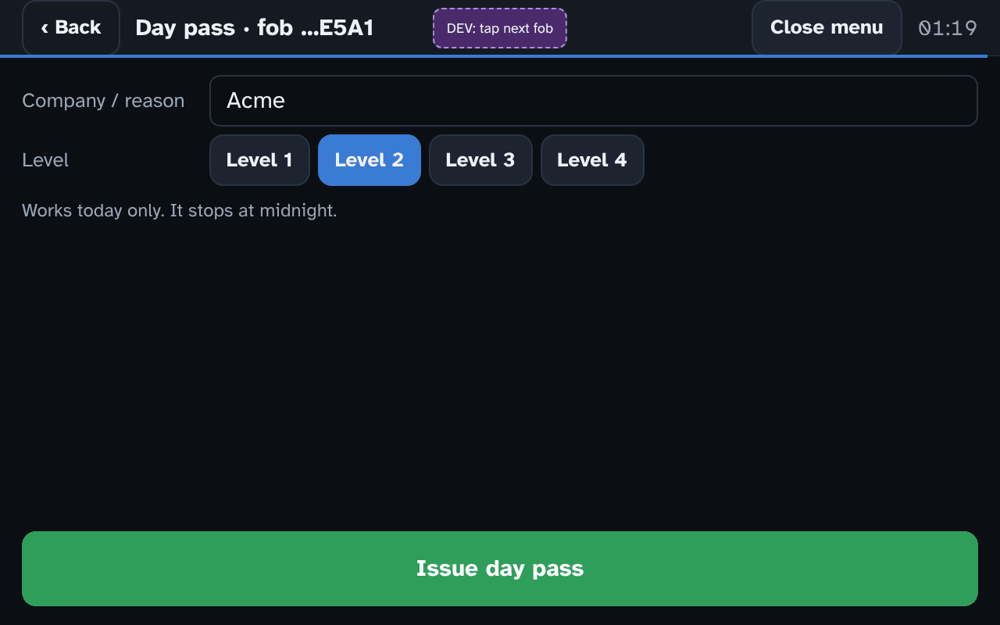 |
| **Show mode** | Every box unlocked, no fob needed. Stays on until turned off or **End of session**. 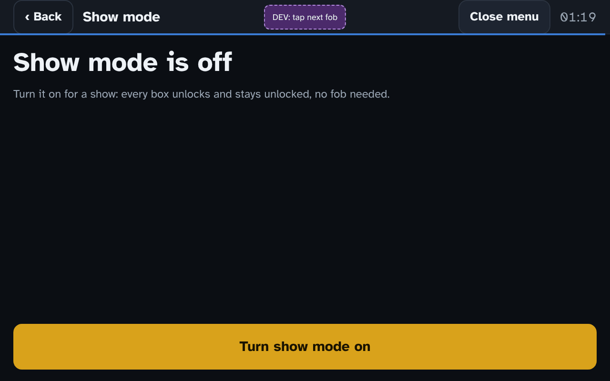 |
| **Force return** | Marks an item as returned, whoever has it. |
| **End of session** | Lists kit still out and boxes still open, then locks every box and turns show mode off. Nobody is signed out. 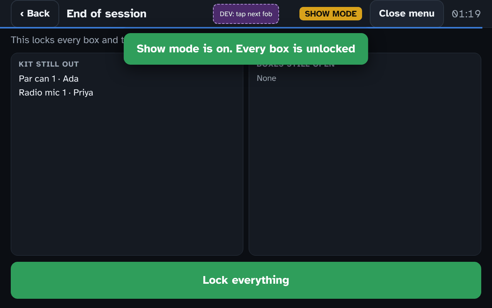 |
| **Event log** | Every tap, sign in/out, kit out/in, box open and admin action, newest first, first names. Filter by type, person, box or kit. 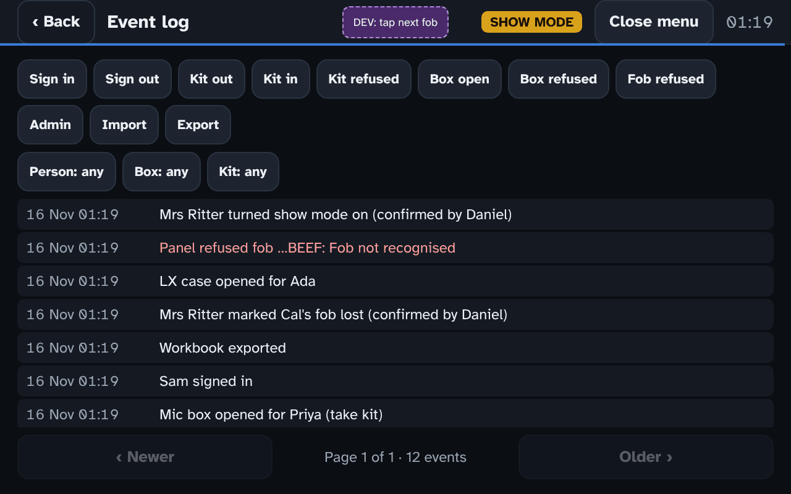 |
| **Hub status** | Version, uptime, temperature, disk, box link (MQTT), fob reader, last backup. 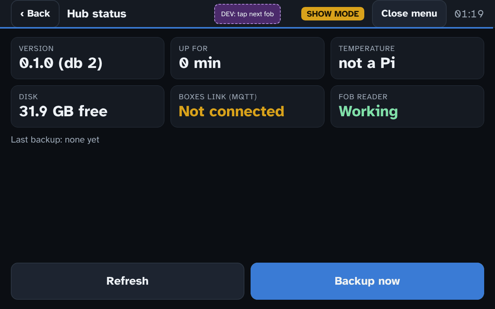 |
| **Backup now** | Copies the database to `/var/lib/tech-access/backups/` on the Pi (newest 14 kept). From week 7 also to the TECHBACKUP stick. |
| **Update from workbook** | Preview a workbook and apply it. For now you choose the file; from week 7 a TECHUPDATE stick opens it by itself. Changes made on the panel since the last export show as **conflicts**: pick *Keep panel* or *Use workbook* for each. 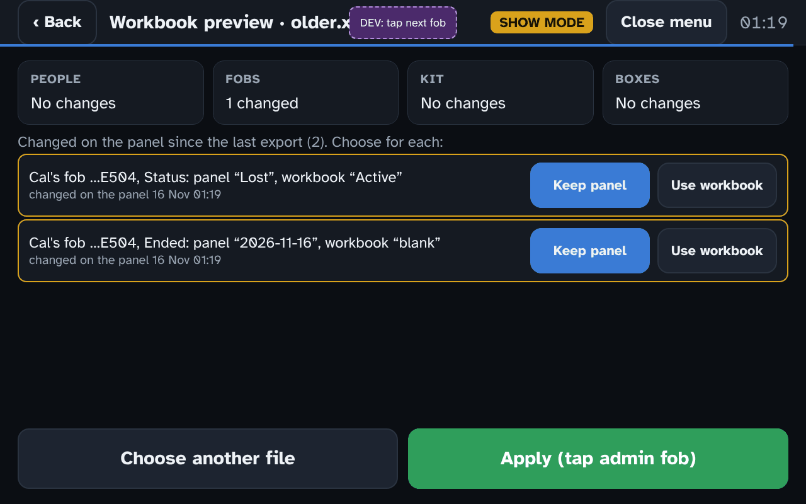 |
| **Restart / reboot** | Restart the hub (back in ~10 s) or reboot the Pi (~1 min). Boxes carry on by themselves meanwhile. Never during a show. |

### People, kit & boxes (the editor)

Since 16 Nov 2026 the panel is the **main copy** of people, fobs, kit and boxes. The workbook is
the readable backup and the tool for big changes. Every save is logged in the event log.

| Tab | |
| --- | --- |
| 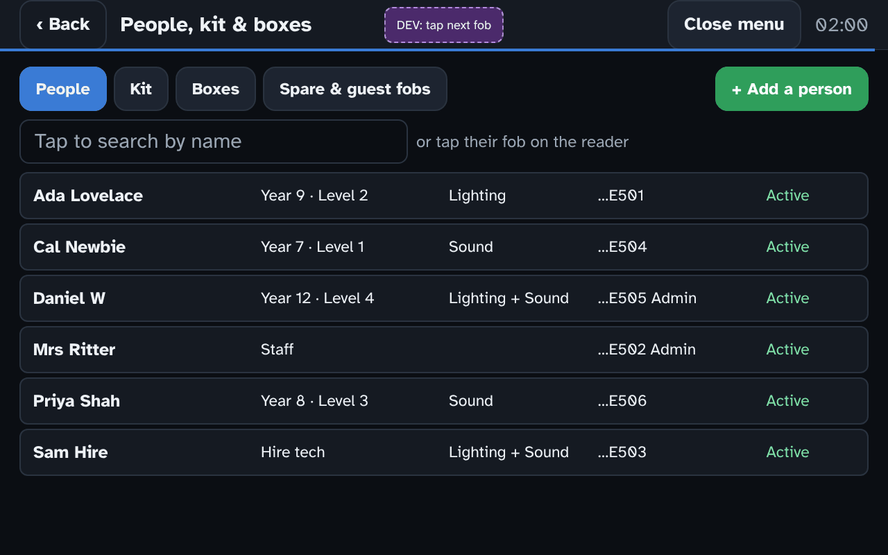 **People** | Everyone, full names, Left at the bottom. **Search**: tap the box and type part of a name, or just **tap their fob** on the reader to open their profile. **+ Add a person** gets the next `P###`. |
| 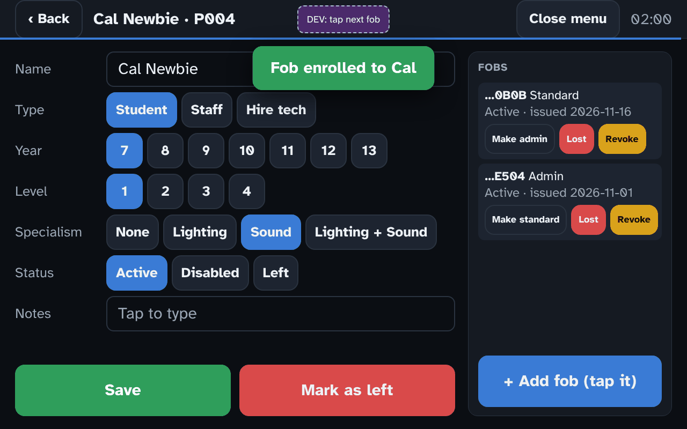 **A person** | Name, type, year, level, specialism, status, notes, then **Save**. **Mark as left** sets Left and revokes their fobs. Right: their fobs. **Make admin / Make standard**, **Lost** (Ended = today; a second lost fob shows the £2 charge), **Revoke**, and **+ Add fob**: tap the new fob on the reader and it's theirs. |
| 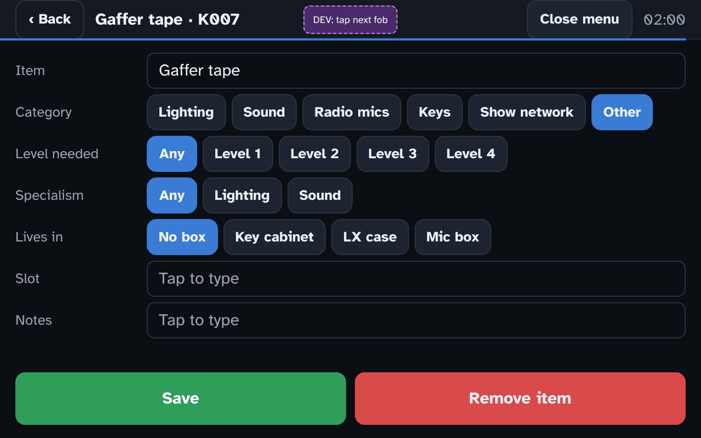 **Kit** | Item, category, level needed, specialism, which box it lives in, slot, notes. **Remove item** (not while it's out). New items get the next `K###`. |
| 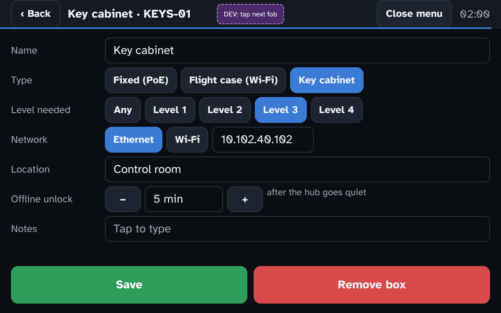 **Boxes** | Name, type, level needed, network and IP address, location, offline unlock minutes, notes. **Remove box** only once no kit lives in it. New boxes get the next `BOX-##`; that ID goes in the box's firmware, so it never changes. |
| 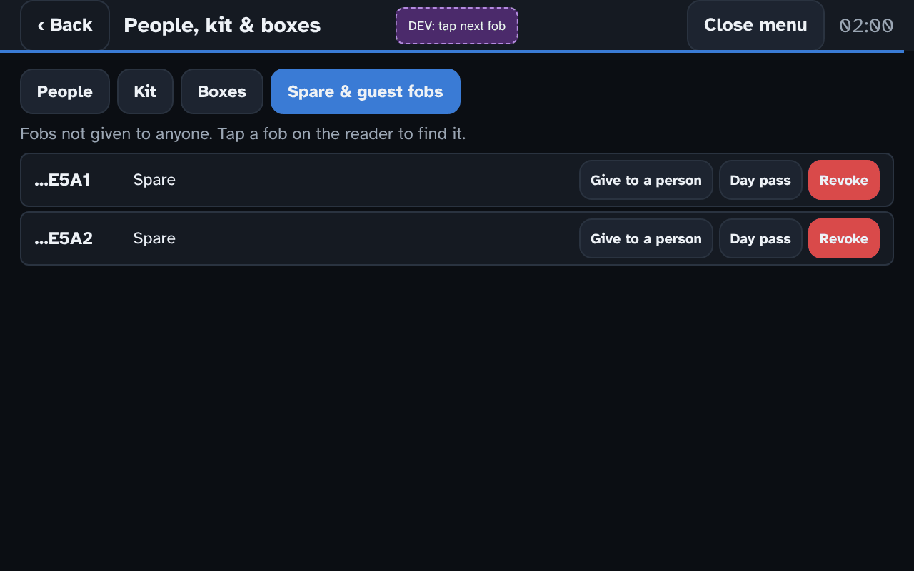 **Spare & guest fobs** | Fobs not given to anyone: **Give to a person**, **Day pass**, **Revoke**. |

Mistakes are fixed the same way: open it and change it back. If you edit the workbook as well,
**export first** and edit that file, so the next import doesn't show conflicts
(see [The workbook](The-Workbook.md)).

The on-screen keyboard appears for names and the day pass reason:
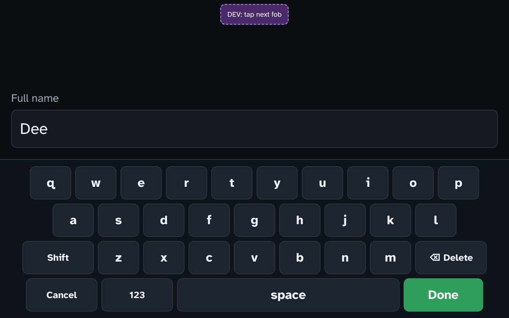

## Every day, automatically

- **03:00**: anyone still signed in is signed out (logged as automatic).
- Day passes stop working at midnight.
- The boxes get a fresh copy of who may open them whenever something changes.

## If the reader isn't found

The panel still works with touch, but no fob opens anything. **Admin → Hub status** (or the
crew card's Hub row) says *Reader not found*. On the Pi:

```bash
curl -s http://127.0.0.1:8080/api/health
```

| `reader.detail` says | Fix |
| --- | --- |
| `reader not found: /dev/ttyAMA0 missing` | The UART is off. `sudo ./07-reader.sh`, then `sudo reboot`. |
| `reader not found: no answer on /dev/ttyAMA0` | Port is there, PN532 silent. Power off; check the DIP switches are HSU (both off); check wiring; swap TX/RX (harmless). See [Hardware](Hardware.md#desk-fob-reader-pn532). |
| `permission denied on /dev/ttyAMA0 (is the hub user in the dialout group?)` | `sudo ./07-reader.sh` (adds `techaccess` to `dialout` and restarts the hub). |
| `... is in use by something else (serial console still on?)` | `sudo ./07-reader.sh`, reboot. |

The hub keeps trying by itself (every 30 s at most), so after a fix it comes back without a
restart. Nothing else in the hub stops while the reader is missing.

## Trying it without the hardware

On any PC with Bun: `cd hub && bun install --frozen-lockfile && bun run build`, then make a demo
database and run with the fake reader:

```bash
bun run scripts/demo-db.ts data/demo.db
```

Put `db_path = "data/demo.db"`, `fake_reader = true` and the printed `fake_fobs = [...]` in a
`config.toml`, then `bun run src/server.ts` and open `http://127.0.0.1:8080/panel/` at
1280×800. The purple **DEV: tap next fob** key in the top bar cycles through `fake_fobs`, or
`curl -X POST http://127.0.0.1:8080/api/dev/tap -H 'Content-Type: application/json' -d '{"uid":"04A1B2C3D4E502"}'`.

## First test on the real hardware

When the screen and the PN532 arrive. Do these in order and paste the output of anything that
fails back to whoever's helping.

**Before you start:** PN532 DIP switches on HSU (both off), wired to 3.3 V as on the
[Hardware](Hardware.md#desk-fob-reader-pn532) page, screen on HDMI0 and its USB lead in a Pi USB port.

1. [ ] `cd /opt/tech-access/pi && sudo ./05-bun-hub.sh`: ends with the health line; "built the desk panel" on the first run.
2. [ ] `sudo ./07-reader.sh`, then `sudo reboot`.
3. [ ] After the reboot: `ls -l /dev/ttyAMA0` exists, group `dialout`.
4. [ ] `stty -F /dev/ttyAMA0 -a | head -2` shows `speed 115200 baud` and `-icanon` (the hub sets it when it opens the port).
5. [ ] `curl -s http://127.0.0.1:8080/api/health`: `"reader": {"kind":"pn532","state":"ok",...,"firmware":"PN532 v1.6"}`.
6. [ ] `journalctl -u tech-access-hub -f`, hold a fob on the reader for 5 s: exactly **one** `tap <UID>` line. Lift it, tap again: one more.
7. [ ] Unplug the PN532's VCC wire (power off first if you prefer): health says `reader error` / `not found`; the hub keeps running. Plug it back: `state: ok` again within 30 s.
8. [ ] `sudo ./06-kiosk.sh`, then `sudo reboot`. The Pi boots to "Starting the desk panel…", then the clock. No mouse cursor, no Chromium bars or pop-ups, no "restore pages".
9. [ ] Touch the screen: nothing happens (nobody's tapped in). Pinch and swipe: no zoom, no back-navigation, no text selection.
10. [ ] Tap a crew fob: card opens with the right first name and level. Take an item, return it, open a box: each shows a plain message. **Admin → Event log** shows each one.
11. [ ] Tap an admin fob: card with the red **Admin panel** button. Open it, then **People, kit & boxes**, and tap a crew fob on the reader: their profile opens.
12. [ ] In the admin menu, turn Show mode on: confirm overlay; a crew fob is refused; an admin fob confirms. Turn it off again the same way.
13. [ ] Leave it alone for **5 minutes**: screen goes off. **Touch** it: screen on, and that touch didn't press anything. Leave it again, then **tap a fob**: screen on and the card opens.
14. [ ] Wake with a fob, then leave it alone: the screen goes off again after 5 minutes (the hub's timer; swayidle doesn't see fob taps).
15. [ ] **Admin → Restart / reboot → Restart the hub**, confirm with a fob: the panel shows "Starting…" or reloads within ~15 s. Then **Reboot the Pi**: back to the clock within a couple of minutes. (If either does nothing: `journalctl -u tech-access-hub -n 20` and look for `systemctl ... failed`; the polkit rule is installed by `06-kiosk.sh`.)
16. [ ] `pkill chromium` over SSH: Chromium comes back by itself within a few seconds.
17. [ ] **Admin → Backup now**: "Backup saved"; `ls /var/lib/tech-access/backups/`.
18. [ ] **Admin → Hub status**: temperature and disk show real numbers.
